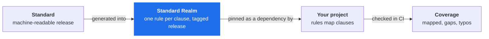

# SteerSpec Hub

**Standards as realms — pin a standard the way you pin core, and measure your rules against every clause.**

[Why](#why) · [How it works](#how-it-works) · [Repositories](#repositories) · [Status](#status)

## Why

*"We cover 80 % of ASVS L2"* needs a denominator. A [SteerSpec](https://steerspec.dev) project sees
only the clauses its own rules map: a clause nobody mapped is invisible, and a typo in a clause
number passes.

SteerSpec Hub publishes standards as versioned **Standard Realms**: every clause, with its own number
and level, as Published rules. SteerSpec itself still holds no clause list. Each realm is published
under the standard's own licence, with attribution to its authors.

## How it works

A project depends on a realm the way it depends on core. Coverage, gaps and clause typos then become
checks its CI can run.

## Repositories

| Repo | What it holds | Licence |
| ---- | ------------- | ------- |
| [**strspc-hb-std-owasp-asvs**](https://github.com/steerspec-hub/strspc-hb-std-owasp-asvs) | OWASP ASVS 5.0.0 as the realm `dev.steerspec.std.owasp.asvs.v5`, generated from OWASP's JSON release | CC BY-SA 4.0 |

More standards follow once the pilot realm ships.

## Status

| Realm | Profile | Requirements | State |
| ----- | ------- | ------------ | ----- |
| OWASP ASVS 5.0.0 | L1 | 70 | In progress |
| | L2 | 253 | Planned |
| | L3 | 345 | Planned |

Things will change. Feedback welcome.

The tooling is [SteerSpec](https://github.com/SteerSpec), Apache 2.0. Each realm carries the licence of its standard.

